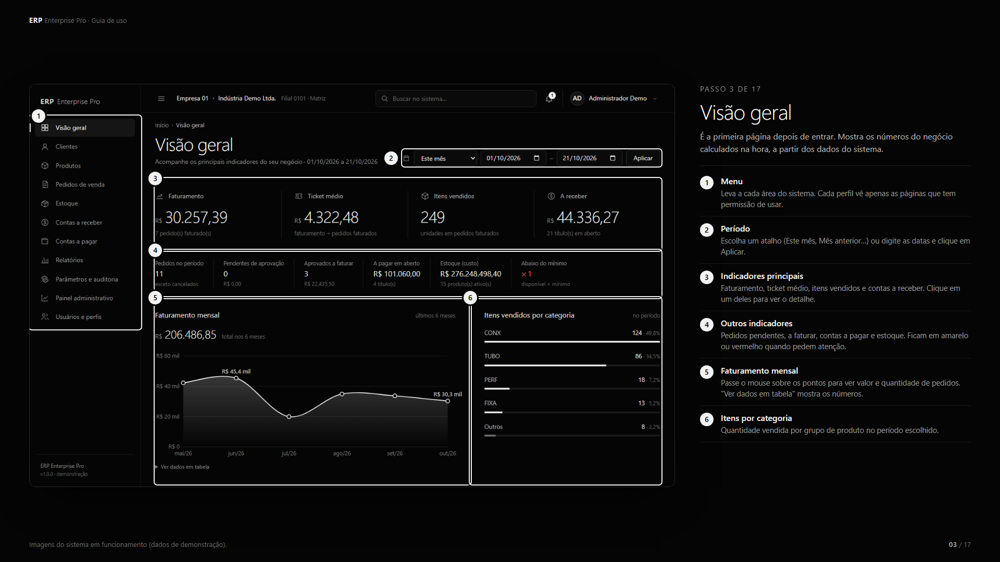

# ERP Enterprise Pro

> 🚧 **Under active development.** The web app runs and its automated tests pass, but features are still being added and changed. Data in the demo is fictitious.

A business management system (ERP) for small and mid-sized companies: sales orders, inventory, customers, finance and reports in one web app, with a live dashboard and role-based access.

*Leia em português: [README.pt-BR.md](README.pt-BR.md)*



## Features

- **Dashboard** with revenue, average ticket, items sold and accounts receivable, plus a 6-month revenue chart
- **Customers** with CPF/CNPJ validation and duplicate blocking
- **Products** and **inventory** with stock reservation, stock movements history (kardex) and minimum-stock alerts
- **Sales orders** with a full workflow: draft → sent → pending approval → approved → invoiced
- **Finance**: accounts receivable and payable, partial and full payments
- **Reports** with filters and CSV export that opens directly in Excel
- **6 user roles** (admin, manager, sales, inventory, finance, read-only), each seeing only what it is allowed to

## Business rules enforced (and tested)

| Rule | How it works |
|---|---|
| No double invoicing | 3 simultaneous invoice requests for the same order: 1 succeeds, 2 are rejected, stock is written off once |
| No overselling | Stock is reserved on approval; available stock already discounts other orders' reservations |
| Discount approval | Discounts above 10% need a manager; the person who created the order cannot approve it |
| Credit limit | Orders above the customer's credit go to approval or are rejected, depending on a setting |
| No duplicate payments | Repeated requests return the same result; a second payment on the same bill is blocked |
| Immutable stock history | Stock movements cannot be edited or deleted in the database |
| Security | Password hashing (scrypt), CSRF protection, login lockout after 5 failed attempts, SQL-injection-safe queries |

## Tech stack

- **Backend:** Node.js 22 (native `node:sqlite` and `node:test`), REST API, layered architecture (HTTP → business services → persistence)
- **Frontend:** vanilla JavaScript (ES modules), HTML and CSS, no framework and no build step
- **Database:** SQLite, money stored as integer cents
- **Dependencies:** none (zero npm packages)

## Run it locally

Requires Node.js 22.5+ (or VS Code installed — the scripts fall back to the Node bundled with it).

```bash
cd web
npm start          # http://localhost:3000
npm test           # automated tests
```

On Windows you can also double-click `iniciar.cmd` (start) or `testar.cmd` (tests).

**Demo users** (password for all: `Demo@2026`): `admin`, `gerente`, `vendedor`, `estoque`, `financeiro`, `consulta`.

## Project structure

```
web/
├── server/      Node.js API: routes, auth, database, business services
├── public/      Frontend: pages, components, charts
└── tests/       End-to-end tests against the real API
docs/            Architecture, API, security, tests and a step-by-step user guide (docs/guia)
protheus/        Reference implementation of the same rules for TOTVS Protheus (ADVPL) — not compiled yet
```

## Status and roadmap

- [x] Core modules: dashboard, customers, products, orders, inventory, finance, reports
- [x] Roles and permissions, audit log
- [x] Automated tests for business rules and security
- [ ] Online demo
- [ ] Purchasing module (accounts payable are currently seeded)
- [ ] Autocomplete search for large customer/product lists
- [ ] Interface tests

The invoicing in this demo does not issue tax documents (NF-e) or calculate taxes.

## Author

**Vinicius Vargas** · Software Engineering student · Cuiabá, Brazil
viniciusvargas0202@gmail.com
